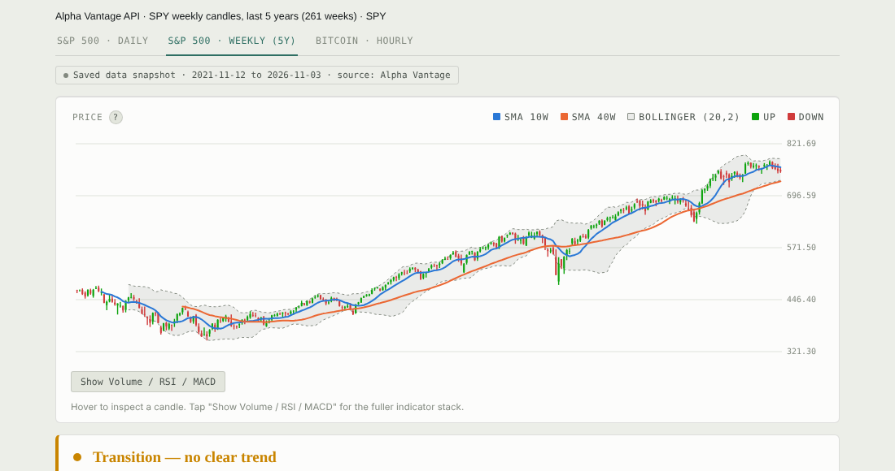

# Daka: Market Trend & Strategy Backtest Dashboard

Built by **[Duresa Daka](https://www.linkedin.com/in/duresa-daka-0298b343b/)** · Computer Information Systems, Arizona State University

**Live demo:** https://claude.ai/artifact/1WcquHHx3yojveWDzGMyFY

An interactive dashboard that tests one question: **do simple, rules-based technical-analysis strategies beat buying and holding, and does the answer change across markets and timeframes?**

## Data
| Dataset | Source | Window |
|---|---|---|
| SPY (S&P 500 ETF), daily | Alpha Vantage REST API | 100 trading days, Jun 12 – Nov 3, 2026 |
| SPY, weekly | Alpha Vantage REST API | 261 weeks, Nov 2021 – Nov 2026 |
| BTC/USDT, hourly | Crypto.com Exchange API | 50 hours, Nov 2 – Nov 4, 2026 |

API responses are parsed, sorted chronologically, and validated before analysis. This public edition runs on a saved snapshot so every number can be reproduced.

## Method
- **Indicators built from scratch** (vanilla JavaScript, no finance or charting libraries): SMA, EMA, RSI, MACD, Bollinger Bands, ATR
- **Rules engine**: turns the indicators into a trend read (uptrend / downtrend / transition) and a 6-point signal-agreement checklist
- **Backtesting**: a moving-average crossover rule plus five mechanical strategies (trend following, mean reversion, 20-bar breakout, MACD momentum, IBS mean reversion), run on the same bars
- **Evaluation**: trade count, win rate, average and compounded return, all benchmarked against buy-and-hold
- **Visualization**: custom SVG candlestick chart with hover inspection, plus volume, RSI and MACD panels

## Key findings (snapshot)
| Dataset | Buy & hold | MA-crossover rule | Best of 5 rules | Rules beating buy & hold |
|---|---|---|---|---|
| SPY daily (100d) | +1.7% | no completed trades | IBS mean reversion, +5.0% (6 trades) | 2 of 5 |
| SPY weekly (5y) | +61.4% | +61.5% (2 trades) | IBS mean reversion, +18.4% (9 trades) | 0 of 5 |
| BTC hourly (50h) | +3.9% | no completed trades | Trend following, +3.5% (1 trade) | 0 of 5 |

**Takeaway:** only 2 of 15 rule-and-dataset combinations beat buy-and-hold, and the best rule was different in each market. Over five years of weekly SPY data, a slow 10/40-week crossover roughly matched buy-and-hold with just two trades, while every faster rule fell well behind. No rule showed a reliable edge.

## Limitations & next steps
- Small, in-sample windows (especially the 50-hour BTC set), so win rates are noisy
- No fees, slippage, or taxes, which would hurt high-turnover rules the most
- Prices aren't dividend-adjusted, so SPY buy-and-hold is slightly understated
- Next: longer histories, an out-of-sample test period, transaction costs, and risk-adjusted metrics (Sharpe ratio, max drawdown)

## Skills demonstrated
REST API data collection · data cleaning & parsing · feature engineering · backtesting & performance metrics · data visualization · dashboard design

## Run it
Open `index.html` in a browser. It's a single self-contained file with no build step.

_Educational analysis only, not investment advice._
